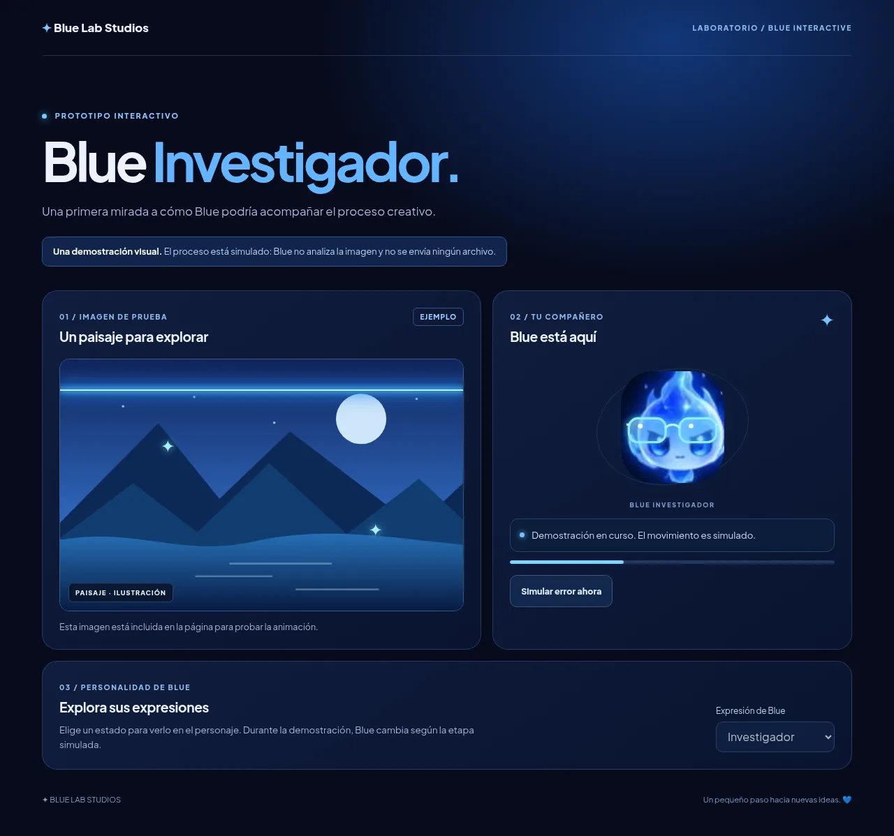

# Blue Interactive: prototipo de Blue Investigador

Este directorio contiene una demostración independiente. El paisaje y la espera son simulados: **no se analiza ninguna imagen**, no se hacen solicitudes a una API y no hay carga de archivos. La barra es indeterminada; no representa porcentajes ni progreso real.



## Abrir la demostración

Desde la raíz del repositorio:

```sh
python3 -m http.server 8080
```

Abre `http://localhost:8080/demos/blue-interactive/`. Pulsa «Iniciar demostración» para ver el estado investigador y el éxito simulado. «Simular error» permite probar el estado de error. El selector permite ver las nueve expresiones.

## Reutilizar a Blue

`blue-character.mjs` registra el elemento web `<blue-character>`. El atributo `expression` acepta `normal`, `feliz`, `curioso`, `sorprendido`, `pensando`, `concentrado`, `triste`, `emocionado` e `investigador`. La ilustración usa las expresiones del recurso oficial `img/blue-referencia.jpg`; las gafas y los reflejos son una capa visual independiente. El atributo `success` muestra una señal de éxito y debe activarse solo cuando la operación realmente termine. Los ojos son parte de la ilustración fija: los reflejos simulan movimiento, no seguimiento real de mirada.

```html
<script type="module" src="/demos/blue-interactive/blue-character.mjs"></script>
<blue-character expression="investigador"></blue-character>
```

Para otros sitios, sirve juntos `blue-character.mjs`, `blue-character.css` y `blue-state.mjs`, y proporciona la URL del recurso oficial en el atributo `asset` si no se conserva la misma estructura de carpetas. Las herramientas anfitrionas deben decidir los estados a partir de sus propios eventos; el componente no recibe imágenes ni sabe si una operación se está ejecutando.

`normalizeProgress` solo acepta porcentajes numéricos finitos entre 0 y 100: los valores inválidos o ausentes devuelven `null`. En una integración futura, usa únicamente valores emitidos por la herramienta; cuando no haya progreso disponible, usa un indicador indeterminado. La demostración no conecta esta función a un proceso real.

## Pruebas

```sh
node --test demos/blue-interactive/blue-state.test.mjs
```

El personaje y la demostración respetan `prefers-reduced-motion`. No incluyen seguimiento del cursor ni respuestas táctiles todavía; se reservan para una integración posterior.
